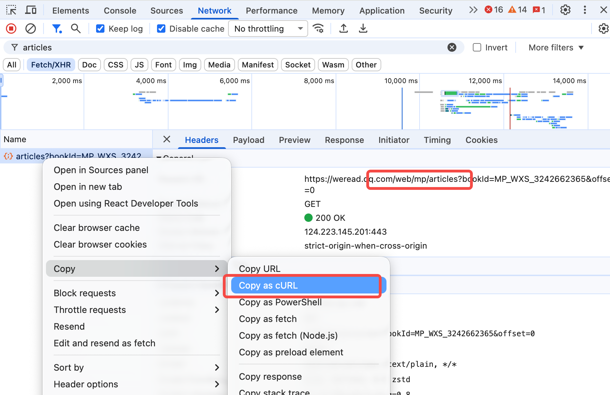

# wechat-mp-rss

这是一个基于微信读书书架的微信公众号文章下载工具。

在微信读书 App 中关注公众号后，工具可以搜索书架里的已关注公众号，并批量下载其文章到本地；下载后的文章也会保存在本地数据库中，方便后续查看、导出或通过 RSS 阅读。

## 使用前准备

1. 安装 Python 3.10 或更高版本；
2. 准备一个可以登录微信读书的微信账号；
3. 在微信读书 App 中关注希望下载的公众号；
4. 在浏览器登录 `weread.qq.com`，并能通过开发者工具复制一次成功的 `/web/mp/articles` 请求完整 cURL。


> 首次使用需要导入该 cURL，以取得读取文章列表所需的登录凭证。请勿将 Cookie、完整 cURL 或凭证文件发送给他人。

## 快速开始

在项目根目录执行：

```bash
cd runtime/wechat-download-api
cp env.example .env
python3 -m venv venv
./venv/bin/pip install -r requirements.txt
./venv/bin/python app.py
```

Windows：

```bat
cd runtime\wechat-download-api
copy env.example .env
py -m venv venv
venv\Scripts\pip install -r requirements.txt
venv\Scripts\python app.py
```

服务启动后，打开：

```text
http://127.0.0.1:5000/login.html
```

将浏览器中复制的 `/web/mp/articles` 完整 cURL 粘贴到登录页并保存。随后打开：

```text
http://127.0.0.1:5000/rss.html
```

在页面中搜索微信读书书架内已关注的公众号，选择需要的账号订阅并执行一次手动轮询。文章抓取完成后，即可在页面中批量下载对应公众号的文章。

## 常见问题

- 搜索不到公众号：请先在微信读书 App 中关注该公众号，搜索范围仅限书架。
- 登录失效或出现 `-2041`：重新从浏览器导入同一登录会话中成功的 `/web/mp/articles` 完整 cURL。
- 文章数大于 0 但无法下载：文章列表已获取，但正文抓取失败；请查看轮询结果中的错误信息后再重试。
- 不要频繁手动轮询；遇到验证码、风险验证或“操作频繁”时应停止请求并更新登录状态。

本项目使用微信读书非公开 Web 接口，仅适合个人或内部使用公开文章。请遵守相关平台条款和适用法律。
